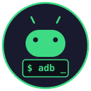

<p align="center">
  
</p>

<h1 align="center">Android ADB Skill</h1>

<p align="center">
  <a href="https://github.com/amit-nayar/android-adb-skill/actions/workflows/test.yml">
    
  </a>
  <br>
  Android device automation for AI coding agents.<br>
  Skill-driven orchestration with a local command layer instead of MCP.
</p>

## What is this?

This repo packages Android automation for agents in two layers:

- `android-adb` (`bin/android-adb`, implemented in `tools/android`) is the shared execution surface.
- `skills/*/SKILL.md` are thin task workflows that compose the command layer.

The goal is to keep the agent experience high-level while keeping the runtime contract deterministic and testable.

The repo includes local tests plus GitHub Actions CI for the shared command layer.

## Why this shape?

This project started from an analysis of [android-mcp-server](https://github.com/martingeidobler/android-mcp-server). An MCP server solves the transport problem, but its useful part is really the command design: screenshots, UI dumps, element targeting, waits, installs, and logs. This repo keeps those capabilities as a plain command-line tool, without a server process.

Compared with a pure markdown skill pack, this structure is better because:

- skills stay short
- device handling is centralized
- text input escaping lives in one place
- UI parsing lives in one place
- agents can rely on `--json` instead of scraping prose

## Prerequisites

- Android SDK with `adb` on your PATH or `ANDROID_HOME` set
- `python3` on your PATH
- A connected Android device or running emulator

## Installation

### Claude Code (plugin)

```text
/plugin marketplace add amit-nayar/android-adb-skill
/plugin install android-adb-skill@android-adb-skill
```

The skills become available as `/android-adb-skill:android`, `/android-adb-skill:android-tap` and so on, and the plugin puts `android-adb` on the `PATH` of Claude's shell. Update with `/plugin marketplace update android-adb-skill`.

### Codex, Cursor, Copilot and other agents

Clone the repo once and put its `bin/` folder on your `PATH`:

```bash
git clone https://github.com/amit-nayar/android-adb-skill ~/.android-adb-skill
echo 'export PATH="$HOME/.android-adb-skill/bin:$PATH"' >> ~/.zshrc   # or ~/.bashrc
```

Then add the instructions file for your agent to each Android project:

| Agent | Instructions file |
|---|---|
| Codex and other agents that read `AGENTS.md` | Copy `AGENTS.md` to the project root. |
| Cursor | Copy `.cursor/rules/android-adb.mdc` to the same path in your project. |
| GitHub Copilot | Copy `.github/copilot-instructions.md` to the same path in your project. |

If your project already has one of these files, merge the contents instead of overwriting it. The instructions point the agent at `android-adb guide`, which prints the command contract and skill workflows from the clone, so nothing else is copied into your project. Update with `git -C ~/.android-adb-skill pull`.

Quick check:

```bash
android-adb device list --json
```

## Command Layer

The shared execution interface is:

```bash
android-adb ...
```

Prefer `--json` whenever the agent needs structured output.

Examples:

```bash
android-adb device list --json
android-adb screenshot --out /tmp/screen.png --json
android-adb ui dump --json
android-adb ui find --by text --value "Login" --exact --json
android-adb input tap-element --by text --value "Login" --json
android-adb input text --text "user@example.com" --json
android-adb wait element --by text --value "Home" --json
android-adb scroll find --by text --value "Privacy" --direction down --json
android-adb app install --apk ./app.apk --json
android-adb app clear-data --package com.example.app --json
android-adb debug logs --package com.example.app --level E --json
android-adb guide android-test
```

See [`docs/command-contract.md`](docs/command-contract.md) (or `android-adb guide contract`) for the full contract.

## Development Workflow

To use this repo as part of an AI-driven Android feature/debug loop, see [`docs/ai-development-workflow.md`](docs/ai-development-workflow.md).

That guide covers:

- how to use this repo from inside an Android app repo
- how an agent can edit, build, install, navigate, verify, and iterate
- Mermaid diagrams for the continuous verification loop

## Testing

Run the local test suite with:

```bash
python3 -m unittest discover -s tests -v
```

CI runs the same suite on Ubuntu and macOS on every push and pull request via [`.github/workflows/test.yml`](.github/workflows/test.yml).

The tests use fake `adb` and `emulator` binaries, so they do not require a real Android SDK or device on the CI runner.

## Skills

| Skill | Purpose |
|---|---|
| `android` | General orchestration |
| `android-screenshot` | Capture and inspect screenshots |
| `android-ui` | Dump and search the UI tree |
| `android-tap` | Tap elements or coordinates |
| `android-navigate` | Multi-step navigation with verification |
| `android-scroll` | Scroll to find off-screen elements |
| `android-gesture` | Swipe, long press, double tap |
| `android-test` | Run a test flow with evidence |
| `android-debug` | Collect logs and diagnose failures |
| `android-install` | Install, launch, reset and uninstall apps |
| `android-device` | Device and emulator management |

## Example Usage

With the Claude Code plugin, skills are prefixed with the plugin name (`/android-adb-skill:android`). Other agents pick the matching guide from `AGENTS.md`.

```text
/android open Settings and navigate to Privacy
/android-tap Login button
/android-test login with user@example.com and verify the home screen
/android-debug crashes in com.example.app after tapping Settings
```

## Repo Structure

```text
android-adb-skill/
├── bin/
│   └── android-adb          # entry point on PATH
├── tools/
│   └── android              # the command layer
├── docs/
│   ├── command-contract.md
│   └── ai-development-workflow.md
├── tests/
│   └── test_tools_android.py
├── skills/
│   ├── android/SKILL.md
│   ├── android-screenshot/SKILL.md
│   ├── android-ui/SKILL.md
│   ├── android-tap/SKILL.md
│   ├── android-navigate/SKILL.md
│   ├── android-scroll/SKILL.md
│   ├── android-gesture/SKILL.md
│   ├── android-test/SKILL.md
│   ├── android-debug/SKILL.md
│   ├── android-install/SKILL.md
│   └── android-device/SKILL.md
├── AGENTS.md
├── .claude-plugin/plugin.json
├── .claude-plugin/marketplace.json
├── .cursor/rules/android-adb.mdc
├── .github/copilot-instructions.md
├── .github/workflows/test.yml
└── README.md
```

## License

MIT
